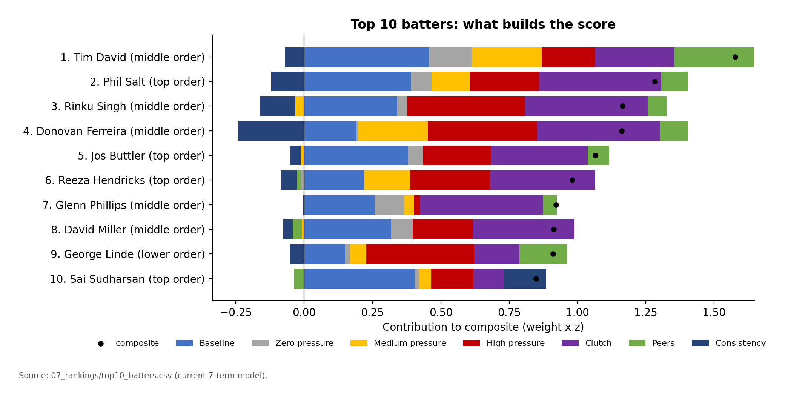
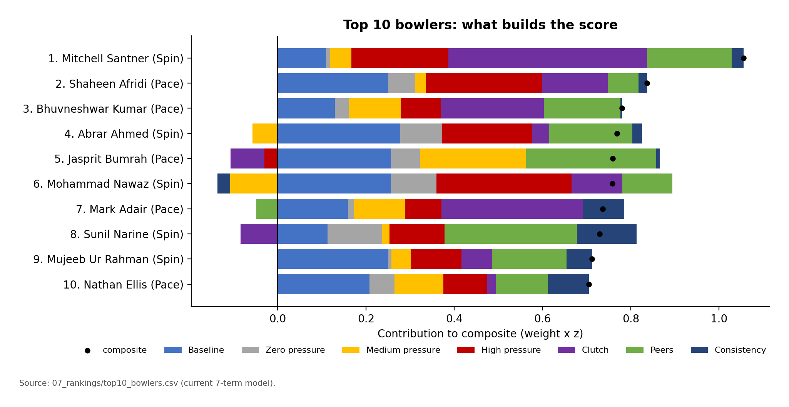
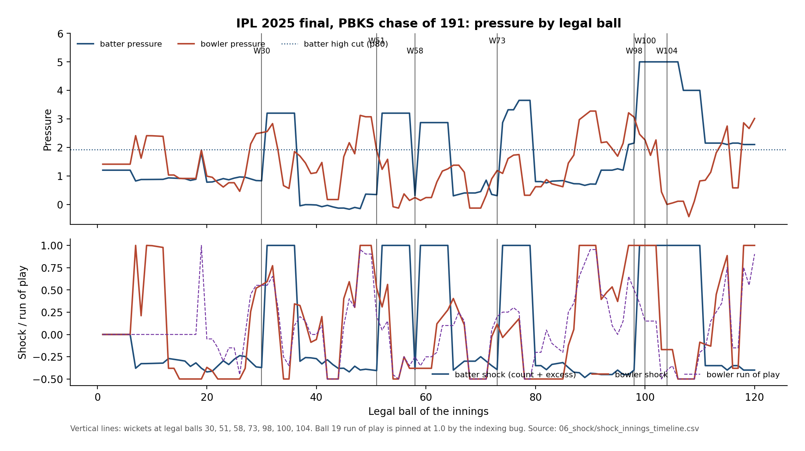
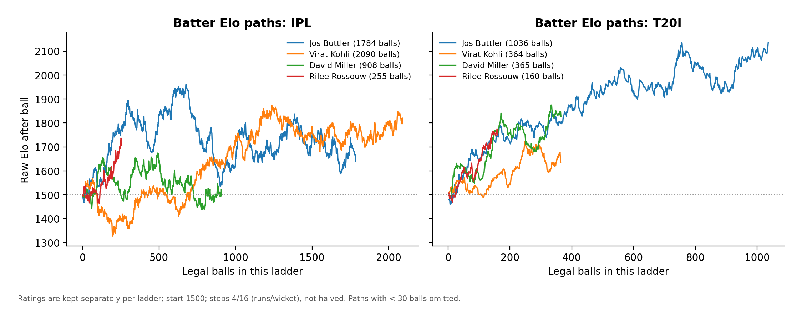

<p align="center">
  <strong>SUPERR</strong>
</p>

<h1 align="center">Who holds their nerve</h1>

<p align="center">
  Pressure-adjusted ratings for T20 batters and bowlers.<br>
  A legal ball is scored against what that ball usually yields.<br>
  Pressure decides which overs count as the hard ones.<br>
  The published number is how a player does across seven pieces of a career.
</p>

<p align="center">
  <a href="website/static/ShouryaPratapSingh_SupeRR_Methodology_Readout.pdf"><strong>Methodology readout</strong></a>
  &nbsp;·&nbsp;
  <a href="research_readout/11_presentation_summary/key_findings.md"><strong>Key findings</strong></a>
  &nbsp;·&nbsp;
  <a href="research_readout/README.md"><strong>Full audit</strong></a>
</p>

<p align="center">
  22 Jan 2022 &nbsp;→&nbsp; 1 Nov 2026 &nbsp;·&nbsp; IPL, T20Is, and a lower T20 ladder
</p>

---

## The board

| | | | | |
|---|---:|---:|---:|---:|
| | **192,445** | **867** | **141** | **143** |
| | legal balls scored | matches with balls | ranked batters | ranked bowlers |

A player appears on the board with **120** decay-weighted legal balls, **60** of them in the high-pressure band. Seasons fade by 0.9 a year back from 2026. Emerging and Rising Stars balls count as half a ball. Super overs stay in.

The same window holds **200,999** deliveries, **888** batters, **647** bowlers and **97** grounds. Nothing in cleaning is deleted. Wides, no-balls and other extras (8,554 deliveries) are not legal balls. Of the legal balls, 101,960 are T20I, 83,755 are IPL, and 6,730 are the lower ladder.

The live board is `website/`. It opens the top 10, a note on why a name is there, the full lists, one innings ball by ball, and a set of weights you can move. Moving a weight changes the short lists in the browser. The top 10 on the page stays the published order.

```
python website/build_data.py
python website/serve.py
```

That serves the board at `http://127.0.0.1:8765/`.

---

## Published top 10

Higher is better. The batting table is spread out: 1st to 10th is 0.73. The bowling table is a pack: 1st to 10th is 0.35.

| | Batter | Score | Runs | SR | | Bowler | Score | Wkts | Econ |
|---:|---|---:|---:|---:|---|---|---:|---:|---:|
| 01 | Tim David | **1.577** | 2,142 | 177 | 01 | Mitchell Santner | **1.055** | 87 | 7.44 |
| 02 | Phil Salt | **1.283** | 2,764 | 170 | 02 | Shaheen Afridi | **0.837** | 65 | 8.01 |
| 03 | Rinku Singh | **1.164** | 1,945 | 153 | 03 | Bhuvneshwar Kumar | **0.780** | 115 | 8.29 |
| 04 | Donovan Ferreira | **1.162** | 561 | 165 | 04 | Abrar Ahmed | **0.769** | 46 | 6.68 |
| 05 | Jos Buttler | **1.065** | 4,384 | 155 | 05 | Jasprit Bumrah | **0.759** | 85 | 7.27 |
| 06 | Reeza Hendricks | **0.981** | 1,220 | 147 | 06 | Mohammad Nawaz | **0.758** | 66 | 7.12 |
| 07 | Glenn Phillips | **0.921** | 1,613 | 148 | 07 | Mark Adair | **0.737** | 56 | 8.72 |
| 08 | David Miller | **0.913** | 1,898 | 149 | 08 | Sunil Narine | **0.729** | 66 | 6.86 |
| 09 | George Linde | **0.910** | 227 | 162 | 09 | Mujeeb Ur Rahman | **0.712** | 48 | 7.03 |
| 10 | Sai Sudharsan | **0.848** | 2,496 | 149 | 10 | Nathan Ellis | **0.705** | 58 | 8.25 |

David’s score is a high career rate, standing out in the innings around him, and the hard spells. Santner’s is the clutch piece, capped, plus the high band. Bumrah’s high-band term is slightly negative. Peers and the baseline carry him. Buttler is 5th, from 34th before the fixes: a long career (strike rate 155, average 42) plus the high-pressure spells. Two IPL finals give some of that back.

Full tables: [`research_readout/07_rankings/final_batter_rankings.csv`](research_readout/07_rankings/final_batter_rankings.csv) and [`final_bowler_rankings.csv`](research_readout/07_rankings/final_bowler_rankings.csv).

<p align="center">
  
</p>

<p align="center">
  
</p>

---

## One ball, then a rank

```
score = 0.20 baseline + 0.10 quiet + 0.15 squeeze + 0.20 high
      + 0.15 clutch   + 0.10 same innings + 0.10 consistency
```

| Piece | Weight | What it reads |
|---|---:|---|
| Baseline | 0.20 | Career strike rate and average, or economy and balls per wicket, against the phases he actually plays |
| Quiet balls | 0.10 | Ball value on the quieter half of balls |
| The squeeze | 0.15 | Ball value once the game starts to tighten |
| High pressure | 0.20 | Ball value in the tightest fifth |
| Clutch | 0.15 | A high-pressure spell of 6 balls or more, against his own rate, and against his teammates |
| Same innings | 0.10 | An innings of 6 balls or more, against teammates and the other side, same day, same pitch |
| Consistency | 0.10 | A narrower spread of match-to-match ball value |

Each piece is a z-score, capped at ±3, on players with at least 30 weighted balls. Batters are compared half inside their role (top, middle, lower) and half against every batter. Bowlers share one pool. A wicket is worth **4 runs** in the ball value.

Pressure sorts the ball. It is not an eighth term.

```
pressure = 0.60 situation + 0.25 shock + 0.15 run of play
```

Situation is the occasion, the competition, and how hard that ball is: phase, wickets down, asking rate. A final is three times a league match. A dead rubber, once a bilateral series is already won, is 0.4. Shock is the previous six balls. Run of play is the last six against the last eighteen, and it starts at ball 19. The current ball is never in either window.

<p align="center">
  
</p>

<p align="center"><em>IPL 2025 final, Punjab Kings chasing 191. Each wicket sends the next six batter balls into the high band. The ball after the fifth wicket is the highest batter pressure in the file.</em></p>

Expectation is fit only on balls already bowled, in a cell of ladder, phase, pace or spin, and wickets down. Elo, the two teams, and the ground shift that cell. They do not set the rank. A run moves a player rating by 4 and a wicket by 16, from a start of 1,500, and the IPL line never mixes with the T20I line. A ground is a shrunk scoring rate, not an Elo.

<p align="center">
  
</p>

The method, the formulas, and the worked examples are in the [methodology readout](website/static/ShouryaPratapSingh_SupeRR_Methodology_Readout.pdf).

---

## What else is in the repo

| | |
|---|---|
| [`player_ratings.py`](player_ratings.py) | The model. Situation, pressure, Elo, expectation, the seven terms, the rank. |
| [`silver/`](silver) | Matches, competitions, teams, playing lists, and the ball-by-ball file the ratings read. |
| [`website/`](website) | The board. `build_data.py` writes `website/data/ratings.db`. `serve.py` serves it. |
| [`website/static/ShouryaPratapSingh_SupeRR_Methodology_Readout.pdf`](website/static/ShouryaPratapSingh_SupeRR_Methodology_Readout.pdf) | The written method. |
| [`research_readout/`](research_readout) | The audit. Every chart and table above is regenerated from the model, inside this folder. |
| [`research_readout/11_presentation_summary/key_findings.md`](research_readout/11_presentation_summary/key_findings.md) | The short list of what changed and what held. |
| [`research_readout/09_limitations/`](research_readout/09_limitations) | The open items, in a register. |
| [`research_readout/10_charts/`](research_readout/10_charts) | One folder of charts per slide. |

The audit’s own map, and how to rerun it, is [`research_readout/README.md`](research_readout/README.md).

---

## Read this with the table

The high band for batters now follows the match. Finals sit in it. A wicket still lifts the next over. For bowlers the same difficulty table pulls the high band toward the powerplay, because wickets down make the bowler’s ball easier. That is a property of the current table, and it is visible in the phase chart.

A single ball is only weakly predictable. Expected runs barely beat a constant. The wickets-down cell is what removes the tail bias: at 8 or 9 down, runs above expectation go from −0.35 a ball to −0.04.

The weights, and the half-and-half role blend, are choices. Neighbouring weights leave the batting order at Spearman 0.90 to 0.96 and the bowling order at 0.86 to 0.95. Dropping the baseline still removes 6 of the top 20 batters and 3 of the top 20 bowlers. The pressure layer is doing work. It is not the whole score.

<p align="center">
  Shourya Pratap Singh &nbsp;·&nbsp; SupeRR Selector, Season 2
</p>
