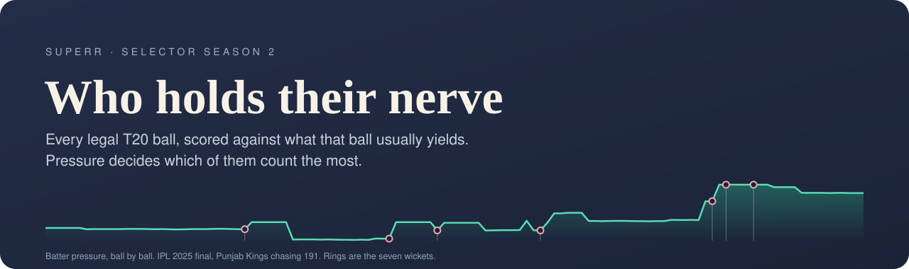
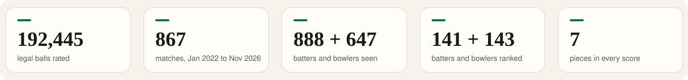
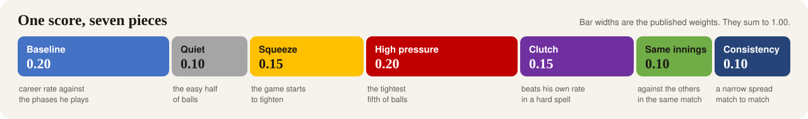
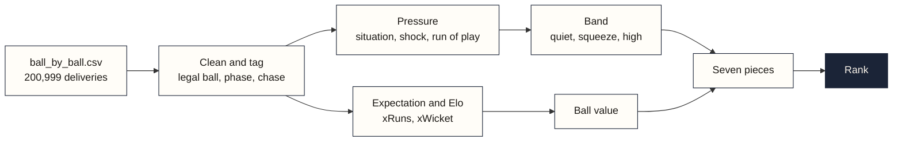
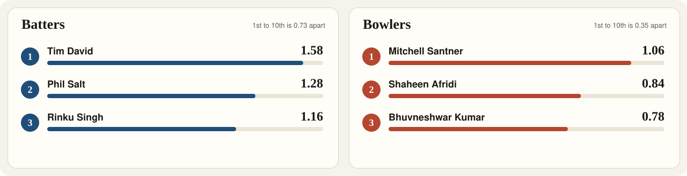
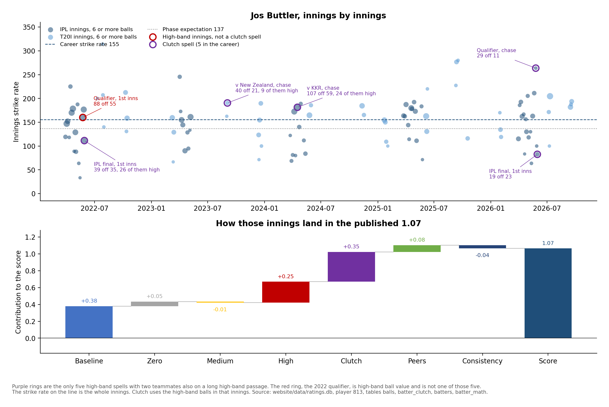
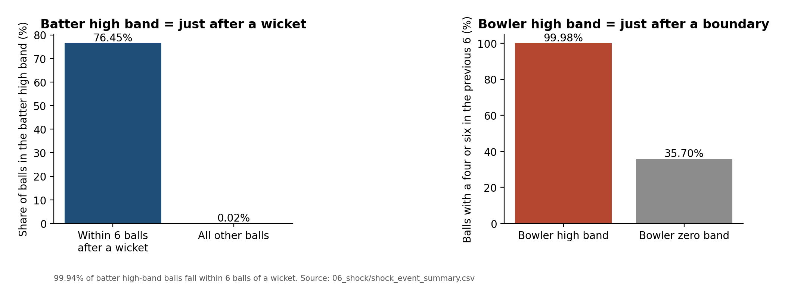
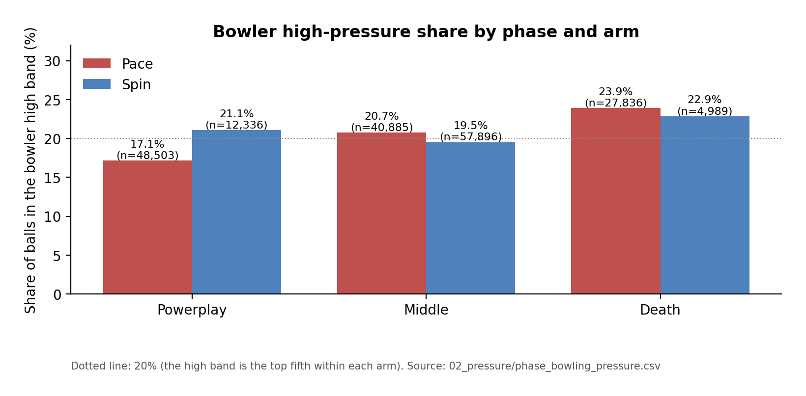
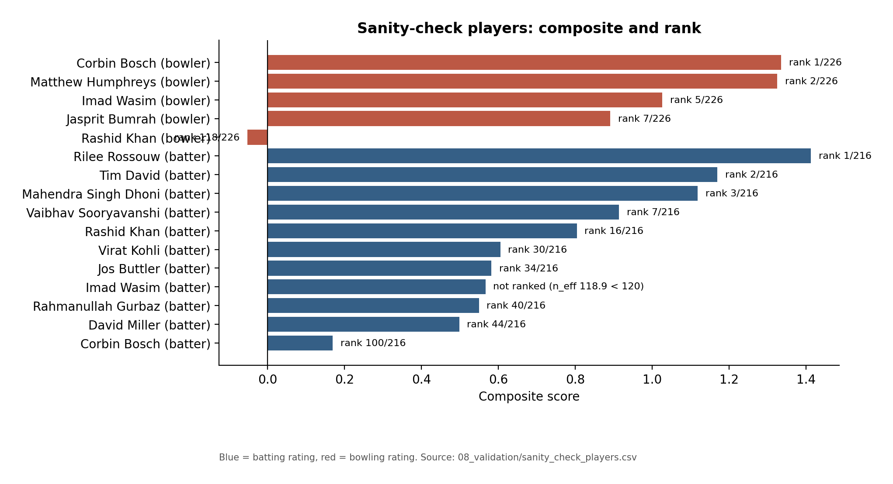
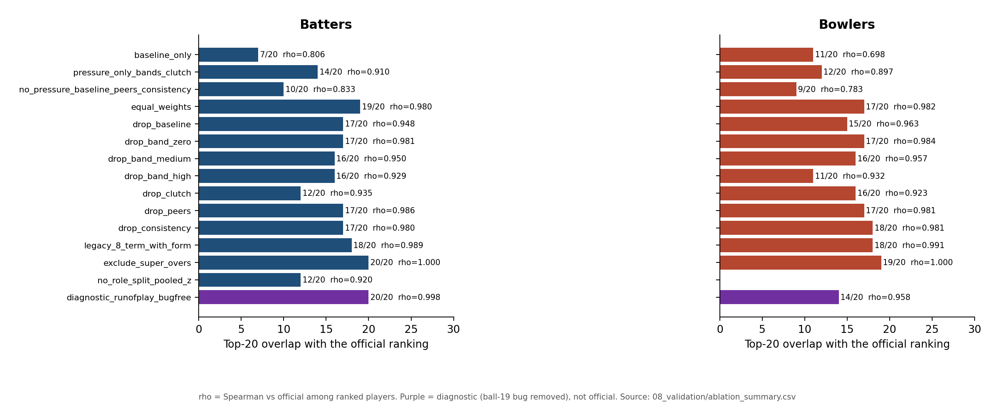

<p align="center">
  
</p>

<p align="center">
  <a href="https://superr-shourya.vercel.app/"></a>
  <a href="website/static/ShouryaPratapSingh_SupeRR_Methodology_Readout.pdf"></a>
  <a href="research_readout/README.md"></a>
  <a href="https://linkedin.com/in/amspsingh04"></a>
</p>

<p align="center">
  
</p>

> **The question.** When a T20 game tightens, who still beats what the ball usually gives?
> This repo answers it for every batter and bowler in 867 matches of IPL, T20I and lower-level T20, from 22 January 2022 to 1 November 2026.

&nbsp;

## The idea, in three moves

<table>
<tr>
<td width="33%" valign="top">

### 1. Price the ball
Every legal delivery gets an expected outcome from what balls like it have produced, using only earlier balls. Phase, wickets down, pace or spin, and a rating gap between batter, bowler, sides and ground all move it. What actually happened, minus that, is the **ball value**. A wicket costs four runs.

</td>
<td width="33%" valign="top">

### 2. Find the hard balls
A pressure score sorts each ball into quiet, tightening or **high**. Most of it is the match: the occasion, the phase, the wickets, the asking rate. A little is the last six balls, and a little is the last eighteen. Pressure only sorts. It is never a score of its own.

</td>
<td width="33%" valign="top">

### 3. Roll up a career
Seven pieces, each set against peers and capped, add up to one number per player. Seasons fade by 0.9 a year. A player needs 120 weighted balls, 60 of them under high pressure, before he is ranked at all.

</td>
</tr>
</table>

<p align="center">
  
</p>



&nbsp;

## The top of the table

<p align="center">
  
</p>

The full ten of each is on the [live dashboard](https://superr-shourya.vercel.app/), and in [`research_readout/07_rankings/`](research_readout/07_rankings). The batting table has room at the top. The bowling table is a pack.

&nbsp;

## What the audit found

Each claim in the readout was checked against the code and the data. These are the ones that survived, and the ones that did not.

| Question | Answer | Evidence |
|---|---|---|
| **Does "high pressure" mean something?** | The match now explains **68.7%** of batter pressure, up from 7.1% when a recent wicket dominated. **86.4%** of final balls sit in the high band. Super overs reach it too: 90.9% for batters, 100% for bowlers. | [`high_band_triggers.png`](research_readout/10_charts/slide_04_high_pressure_meaning/high_band_triggers.png) |
| **Does a wicket still matter?** | Yes, but it no longer decides everything. **75.6%** of batter high-band balls follow a wicket, down from 99.9%. | [`shock_event_summary.csv`](research_readout/06_shock/shock_event_summary.csv) |
| **Do expected runs and wickets add anything?** | Barely, ball by ball. Error per ball is **1.299** against **1.328** for a constant, and the wicket model's AUC is **0.560**. The wickets-down cell is what earns its place: runs above expectation at 8 or 9 down go from −0.345 to −0.044 a ball. | [`calibration_deciles.png`](research_readout/10_charts/slide_05_expectation_models/calibration_deciles.png) |
| **Is the pressure layer decoration?** | No. Baseline alone agrees with the full score on **10 of the top 20** batters and 10 of the top 20 bowlers. Rank correlation is 0.78 and 0.66. | [`ablation_overlap.png`](research_readout/10_charts/slide_12_ablation/ablation_overlap.png) |
| **Does it survive a nudge?** | The order holds. Four other pressure weightings, equal thirds included, keep the batting order at Spearman **0.86 to 0.96** and the bowling order at **0.84 to 0.95**. The exact top 20 does move: 8 to 17 of 20 stay. Dropping super overs changes nothing at the top. Halving or doubling the Elo step moves rank correlation by about 0.01. | [`pressure_weight_sensitivity.png`](research_readout/10_charts/slide_04_high_pressure_meaning/pressure_weight_sensitivity.png) |
| **What broke on the way?** | Six fixes went in. The worst was a look-ahead at ball 19 that read the innings total into the run-of-play window. The ranking floor went from 30 to 60 high-band balls, so a bowler cannot reach the top 10 on a thin sample. Against the model before the fixes, 9 of the top 20 batters and 12 of the top 20 bowlers are still there. | [`model_fixes.md`](research_readout/12_model_fixes/model_fixes.md) |

&nbsp;

## One shock, one career

<table>
<tr>
<td width="50%" valign="top" align="center">

<br><sub><b>A wicket resets the next six balls.</b> IPL 2025 final, Punjab Kings chasing 191. It is a final, so pressure starts high. Wickets at balls 30, 51, 58 and 73 each send the next six into the band. After the fifth, at ball 98, batter pressure passes 8.</sub>
</td>
<td width="50%" valign="top" align="center">

<br><sub><b>Jos Buttler, 5th of 141.</b> A strike rate of 155 across five years gives the baseline. Five high-pressure spells give the clutch term: a 107 off 59 chase against KKR and an 11-ball qualifier cameo lift it, and two IPL finals pull it back.</sub>
</td>
</tr>
</table>

&nbsp;

## Does it see pressure where a cricketer would?

<table>
<tr>
<td width="50%" valign="top" align="center">

<br><sub><b>What the batter high band is made of.</b> Death overs are 49% of it, chases are 64%, and knockouts are in it. A recent wicket still lifts a ball, but it no longer decides.</sub>
</td>
<td width="50%" valign="top" align="center">

<br><sub><b>The bowler side, and where it disagrees.</b> The high band is cut inside pace and inside spin. It still sits mostly in the powerplay: 35% of pace powerplay balls are high, against 9% at the death.</sub>
</td>
</tr>
<tr>
<td width="50%" valign="top" align="center">

<br><sub><b>Known names, known stories.</b> Established players land where a coach would expect them. Short samples are held out of the table, and the chart says why.</sub>
</td>
<td width="50%" valign="top" align="center">

<br><sub><b>Take a piece out, see who moves.</b> Each bar is how many of the official top 20 survive. Baseline alone keeps only 10.</sub>
</td>
</tr>
</table>

&nbsp;

## Where it is soft

> [!WARNING]
> **The bowler high band leans toward the powerplay.** 72.1% of pace high-band balls are in the powerplay and 10.5% at the death. A cricketer would expect it the other way. It comes from the bowler difficulty table, which makes a ball easier once wickets are down. It is left as found and written up as limitation M-17.

> [!NOTE]
> **The weights and the role mix are choices, not discoveries.** The pressure weights are 0.60, 0.25 and 0.15. Batters are compared half within their role and half against everyone. The audit shows what each choice does to the table, and does not claim either is the truth. Season decay was not re-run as a sensitivity.

> [!NOTE]
> **A single ball is hard to predict.** The expected-runs model explains 1.6% of the variance in a ball. It sets a fair baseline, not a forecast.

The full register of limitations, with status, is in [`research_readout/09_limitations/`](research_readout/09_limitations).

&nbsp;

## Run it

<details>
<summary><b>The dashboard, locally</b></summary>

```bash
pip install pandas numpy
python website/build_data.py     # runs the model, writes website/data/ratings.db and ratings/*.csv
python website/serve.py          # http://127.0.0.1:8765/
```

The public site serves `website/static` and an `/api` function from `api/index.py`.

</details>

<details>
<summary><b>The audit, from scratch</b></summary>

```bash
pip install pandas numpy matplotlib
cd research_readout/_scripts
python run_pipeline.py
python a_dataset_pressure.py
python b_components_elo_models.py
python c_shock_rankings_validation.py
python d_charts.py
python e_reports.py
python f_summary_txt.py
```

It takes several minutes. The scripts write only inside `research_readout/`. Start at [`11_presentation_summary/slide_by_slide_numbers.md`](research_readout/11_presentation_summary/slide_by_slide_numbers.md).

</details>

<details>
<summary><b>Redraw the graphics on this page</b></summary>

```bash
python assets/build_assets.py
```

The banner is the real pressure series from the IPL 2025 final. The podium reads the published top-10 tables.

</details>

&nbsp;

## What is where

```
player_ratings.py            the model: situation, pressure, Elo, expectation, seven pieces, rank
silver/                      cleaned matches, competitions, teams, playing lists, ball by ball
website/                     the dashboard: build_data.py, serve.py, static/ (the report PDF is here too)
api/                         the serverless entry point for the public dashboard
ratings/                     batters.csv and bowlers.csv, the published scores
research_readout/
  01_dataset  02_pressure  03_components  04_elo  05_expectation_models  06_shock
  07_rankings  08_validation  09_limitations  10_charts  11_presentation_summary  12_model_fixes
assets/                      the graphics above and the script that draws them
```

<p align="center">
  <sub>Built by <a href="https://linkedin.com/in/amspsingh04">Shourya Pratap Singh</a> for SupeRR Selector, Season 2.</sub>
</p>
